# Arithmetic

<p align="center">
  
</p>

<p align="center">
  <strong>A scientific calculator for Linux.</strong><br>
  Built with Rust and <a href="https://slint.dev">Slint</a>.
</p>

<p align="center">
  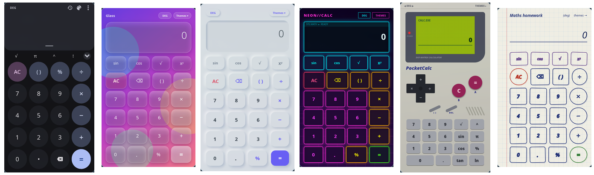
</p>

---

## Installation

### Arch Linux

```bash
sudo pacman -U ./arithmetic-*.pkg.tar.zst
```

### Debian / Ubuntu

```bash
sudo dpkg -i arithmetic-*.deb
```

### Fedora / RHEL / openSUSE

```bash
sudo dnf install ./arithmetic-*.rpm
```

### AppImage

```bash
chmod +x arithmetic-*.AppImage
./arithmetic-*.AppImage
```

### Build from Source

```bash
cargo build --release
```

---

## Skins

The whole calculator UI is a skin. Skins are standalone folders loaded at
runtime, so you can add, edit or remove one without rebuilding Arithmetic.
A skin can offer several **layouts** (different arrangements of the keys) and
several **colour themes**. Press `T` / `F2`, or use a skin's **Themes** button,
to open the skin picker and choose a skin, layout and colour. Arithmetic
remembers the layout and colour you last used with each skin.

### Gallery

<table>
  <tr>
    <td align="center">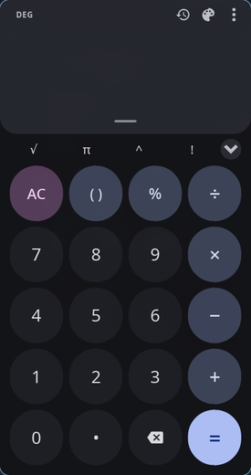<br><b>Material You</b></td>
    <td align="center">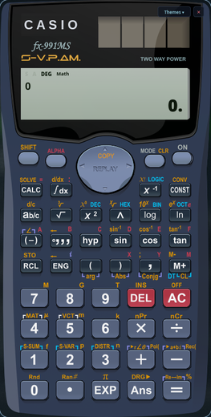<br><b>Casio fx-991MS</b></td>
    <td align="center">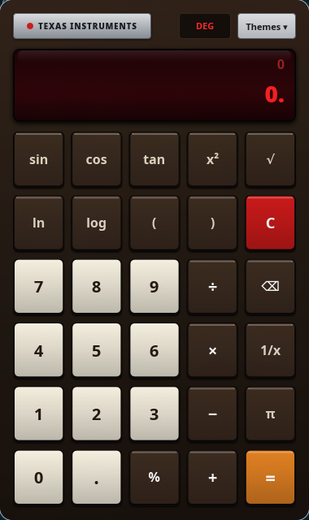<br><b>TI Datamath 1977</b></td>
    <td align="center">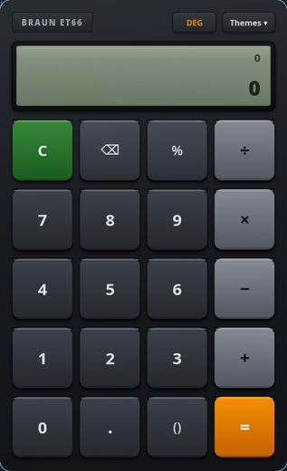<br><b>Braun ET66</b></td>
  </tr>
  <tr>
    <td align="center">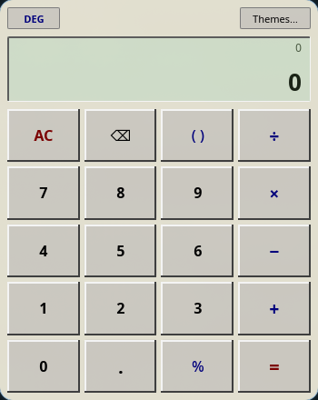<br><b>Classic Desktop</b></td>
    <td align="center">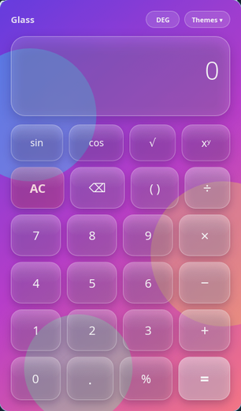<br><b>Glassmorphism</b></td>
    <td align="center">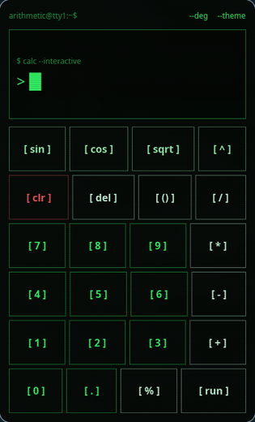<br><b>Terminal</b></td>
    <td align="center">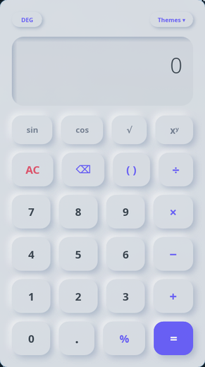<br><b>Neumorphism</b></td>
  </tr>
  <tr>
    <td align="center">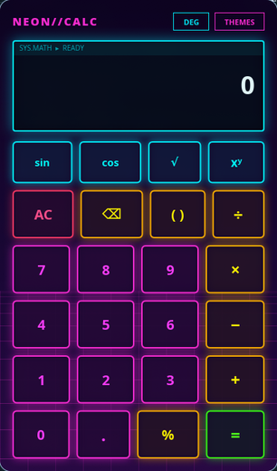<br><b>Cyberpunk Neon</b></td>
    <td align="center">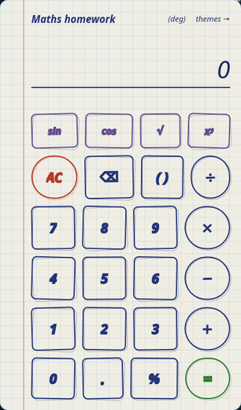<br><b>Paper Notebook</b></td>
    <td align="center">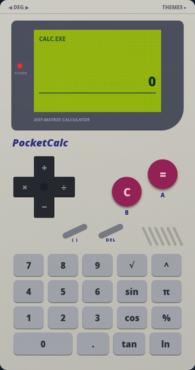<br><b>Retro Handheld</b></td>
    <td align="center">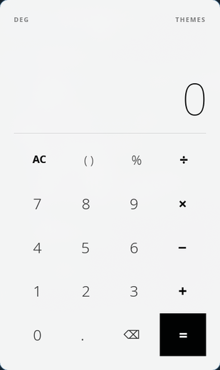<br><b>Minimal Mono</b></td>
  </tr>
  <tr>
    <td align="center">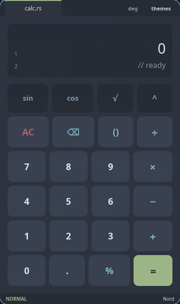<br><b>Dev Palettes</b></td>
  </tr>
</table>

#### Layouts

<table>
  <tr>
    <td align="center">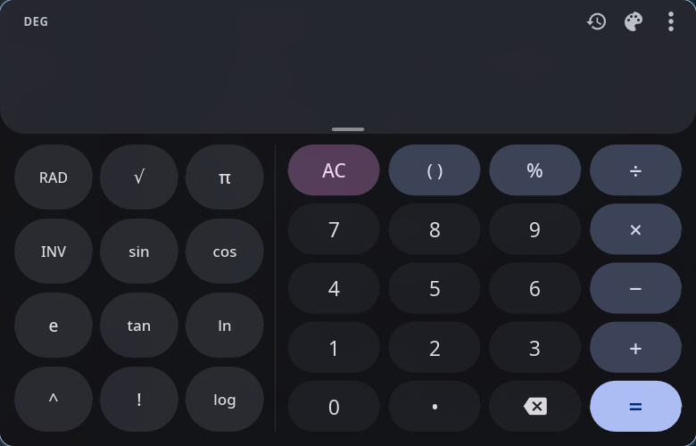<br><b>Material You · Large</b></td>
    <td align="center">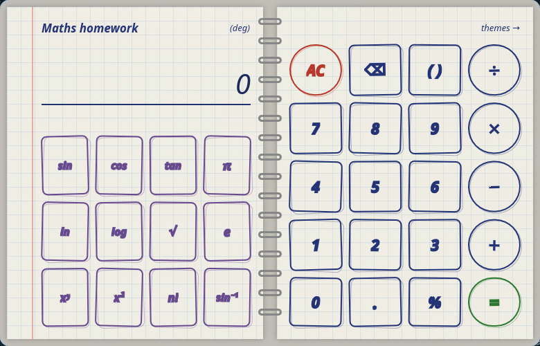<br><b>Paper Notebook · Open Spread</b></td>
  </tr>
  <tr>
    <td align="center">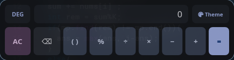<br><b>Material You · Compact</b></td>
    <td align="center">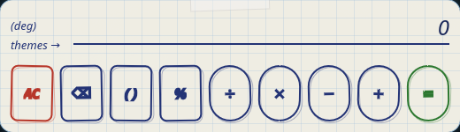<br><b>Paper Notebook · Sticky Note</b></td>
  </tr>
</table>

#### Colour themes

<table>
  <tr>
    <td align="center">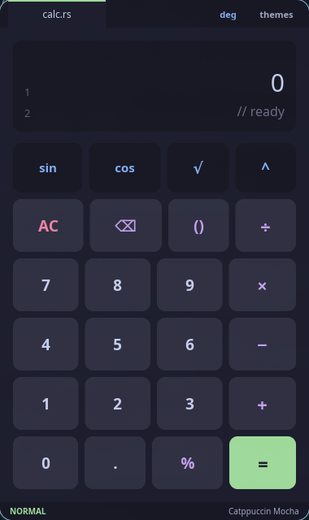<br><b>Dev Palettes · Mocha</b></td>
    <td align="center">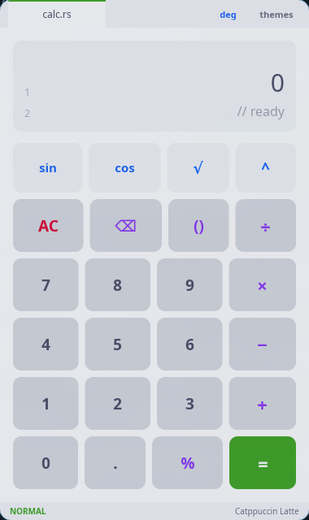<br><b>Dev Palettes · Latte</b></td>
    <td align="center">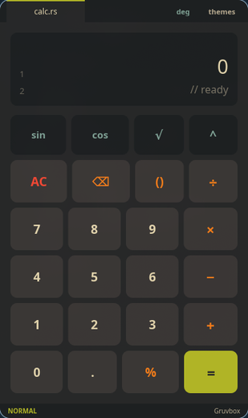<br><b>Dev Palettes · Gruvbox</b></td>
    <td align="center">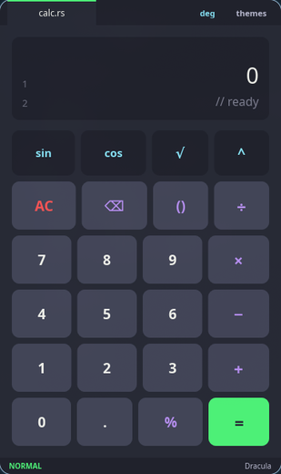<br><b>Dev Palettes · Dracula</b></td>
    <td align="center">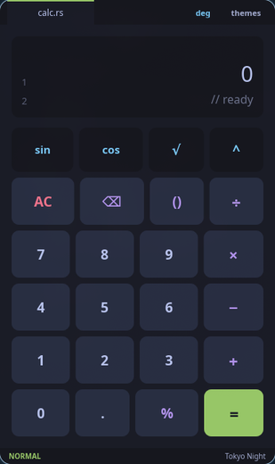<br><b>Dev Palettes · Tokyo Night</b></td>
  </tr>
  <tr>
    <td align="center">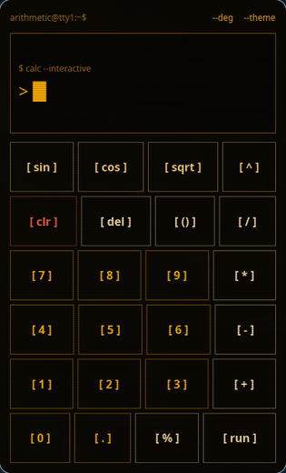<br><b>Terminal · Amber</b></td>
    <td align="center">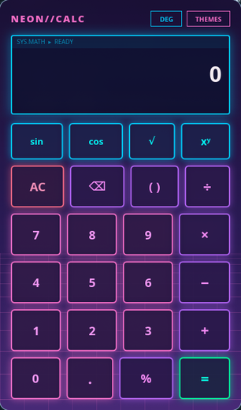<br><b>Cyberpunk Neon · Vaporwave</b></td>
    <td align="center">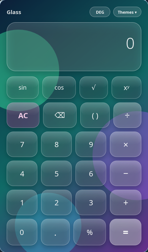<br><b>Glassmorphism · Aurora</b></td>
    <td align="center">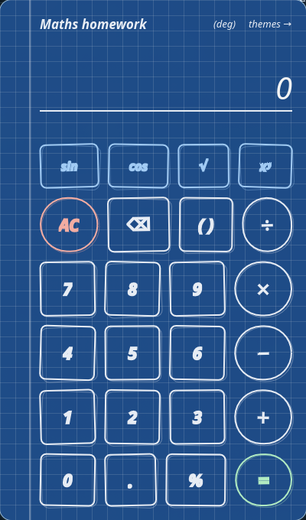<br><b>Paper Notebook · Blueprint</b></td>
    <td align="center">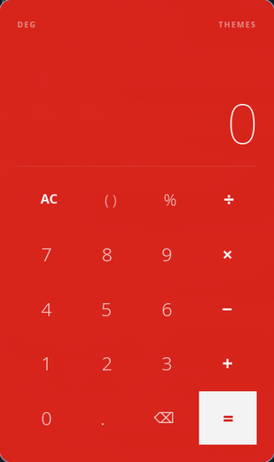<br><b>Minimal Mono · Swiss Red</b></td>
  </tr>
</table>

### Bundled Skins

| ID | Layouts | Colour themes | Style |
| --- | --- | --- | --- |
| `material-3` | Standard, Compact, Large | System, Light, Dark | Material You with history drawer and scientific panel |
| `classic-desktop` | Standard | Classic, Slate, High Contrast | 90s desktop calculator with bevelled keys |
| `casio-fx991ms` | Standard | — | Photo-real Casio fx-991MS |
| `ti-datamath-1977` | Standard | Original Brown, Black LCD | 1970s TI Datamath with red LED display |
| `braun-et66` | Standard | Black, White | Dieter Rams' Braun ET66 |
| `glassmorphism` | Standard | Sunset, Ocean, Aurora | Frosted glass over a gradient |
| `terminal` | Standard | Green, Amber, Cyan | Phosphor console with scanlines |
| `neumorphism` | Standard | Light, Dark, Sand | Soft extruded keys |
| `cyberpunk-neon` | Standard | Neon, Vaporwave, Toxic | Neon glow over a synthwave grid |
| `dev-palettes` | Standard | Nord, Catppuccin Mocha, Catppuccin Latte, Gruvbox, Dracula, Tokyo Night | Editor colour schemes |
| `paper-notebook` | Notebook, Sticky Note, Open Spread | Graph Paper, Legal Pad, Blueprint | Hand-inked keys on paper |
| `retro-handheld` | Standard | Classic Grey, Pocket Silver, Berry | Dot-matrix handheld with D-pad operators |
| `minimal-mono` | Standard | Light, Dark, Swiss Red | Swiss-style type with no borders or shadows |

### Installing a Skin

Copy the skin folder into one of these directories (searched in this order; the first skin with a given ID wins):

1. `~/.config/arithmetic/skins/<skin-id>/`
2. `~/.local/share/arithmetic/skins/<skin-id>/`
3. `<exe-dir>/skins/` and `<exe-dir>/../share/arithmetic/skins/`
4. `$APPDIR/skins/` (inside the AppImage)
5. `/usr/share/arithmetic/skins/` and `/usr/local/share/arithmetic/skins/` (bundled skins)

Then press **Reload** in the skin picker. Reload also recompiles the active
skin, so you can edit a skin and see the result immediately. Debug builds
(`cargo run`) load this repository's `skins/` folder first.

### Writing a Skin

A skin is a folder containing a `manifest.json`, one `.slint` file per layout,
and any images or helper `.slint` files it needs:

```json
{
  "id": "my-skin",
  "name": "My Skin",
  "version": "1.0.0",
  "author": "You",
  "description": "One line shown in the skin picker",
  "preview": "previews/dark.png",
  "default_layout": "standard",
  "layouts": [
    { "id": "standard", "name": "Standard", "file": "skin.slint", "width": 400.0, "height": 680.0 },
    { "id": "compact", "name": "Compact", "file": "compact.slint", "width": 520.0, "height": 150.0 }
  ],
  "default_color_theme": "dark",
  "color_themes": [
    { "id": "dark", "name": "Dark", "swatch": ["#1E1E2E", "#CBA6F7"], "preview": "previews/dark.png" },
    { "id": "light", "name": "Light", "swatch": ["#EFF1F5", "#8839EF"], "preview": "previews/light.png" }
  ]
}
```

| Field | |
| --- | --- |
| `layouts` | at least one; `width` / `height` is the window size in logical pixels |
| `default_layout` | layout used the first time the skin is opened |
| `color_themes` | optional; leave it out (or empty) for a skin with a single look |
| `swatch` | one to three hex colours drawn as the theme's swatch in the picker |
| `preview` | optional image shown in the picker; a colour theme's own `preview` takes precedence |

Each layout file must export a component named `AppWindow` that inherits `Window`.
Skins are compiled in isolation. They can import other files from their own
folder (and use `std-widgets.slint`), but nothing from the application or
from other skins. To share code between a skin's layouts, put it in a file in
the skin's folder, as `skins/paper-notebook/parts.slint` does.

Arithmetic drives the skin through these properties and callbacks. Only the
ones marked *required* must exist; declare the rest only if your skin uses them.

| Name | Kind | |
| --- | --- | --- |
| `expression` | `in-out property <string>` | required: current input |
| `preview-result` | `in-out property <string>` | required: live result, or the error message |
| `is-error` | `in-out property <bool>` | required: `preview-result` holds an error |
| `use-radians` | `in-out property <bool>` | required: angle unit |
| `press-key(string)` | `callback` | required: see key strings below |
| `open-skin-dialog()` | `callback` | required: opens the skin picker |
| `color-theme` | `in-out property <string>` | required if the manifest lists `color_themes`: the active theme ID |
| `set-color-theme(string)` | `callback` | change and save the colour theme from inside the skin |
| `toggle-angle-unit()` | `callback` | switches DEG / RAD |
| `cursor-byte-offset` | `in-out property <int>` | caret position, for skins with an editable `TextInput` |
| `expression-edited()` | `callback` | call after the user edits `expression` directly |
| `set-cursor(int)` | `public function` | host moves the caret after a key press |
| `just-evaluated` | `in-out property <bool>` | the expression is a fresh result |
| `history` | `in-out property <[HistoryEntry]>` | `HistoryEntry { expression: string, result: string }` |
| `select-history-item(string)` | `callback` | load a history value into the input |
| `clear-history()` | `callback` | wipe saved history |
| `switch-skin(string)` | `callback` | jump straight to another skin by ID |
| `close-window()` | `callback` | quit, for frameless skins |

The easiest way to support colour themes is a `global` in the skin whose
colours depend on `color-theme`, bound to the window's property:

```slint
global Colors {
    in-out property <string> color-theme: "dark";
    out property <color> background: color-theme == "light" ? #EFF1F5 : #1E1E2E;
}

export component AppWindow inherits Window {
    in-out property <string> color-theme <=> Colors.color-theme;
    background: Colors.background;
    // ...
}
```

Changing the colour theme in the picker only sets `color-theme`, so it applies
instantly; changing the layout loads the other `.slint` file.

**Key strings** for `press-key`: `0`–`9`, `.`, `+`, `−`, `×`, `÷`, `^`, `%`, `!`, `π`, `e`,
`()` (smart bracket), `AC`, `BACKSPACE`, `=`, and functions that open a bracket:
`sin(`, `cos(`, `tan(`, `sin⁻¹(`, `cos⁻¹(`, `tan⁻¹(`, `log(`, `ln(`, `√(`, `10^(`, `e^(`.

Any bundled skin is a good starting point: `skins/glassmorphism/` is a
complete single-file example with colour themes, and `skins/paper-notebook/`
shows several layouts sharing one file of parts.

---

## Keyboard Shortcuts

| Key | Action |
| --- | --- |
| `0` - `9`, `.` | Input numbers and decimal point |
| `+`, `-`, `*`, `/` | Arithmetic operators |
| `^`, `%`, `!` | Power, percentage, factorial |
| `(`, `)` | Parentheses |
| `Enter` or `=` | Calculate result |
| `Backspace` | Delete character or token |
| `Esc` or `C` | Clear input |
| `T` or `F2` | Open the skin picker |

---

## License

Distributed under the [MIT License](LICENSE).
