# Arithmetic

<p align="center">
  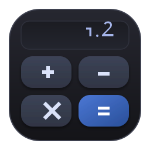
</p>

<p align="center">
  <strong>A scientific calculator for Linux.</strong><br>
  Built with Rust and <a href="https://slint.dev">Slint</a>.
</p>

<p align="center">
  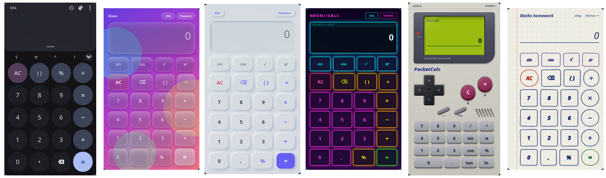
</p>

---

## Installation

### Arch Linux

```bash
sudo pacman -U ./arithmetic-*.pkg.tar.zst
```

### Debian / Ubuntu

```bash
sudo dpkg -i arithmetic-*.deb
```

### Fedora / RHEL / openSUSE

```bash
sudo dnf install ./arithmetic-*.rpm
```

### AppImage

```bash
chmod +x arithmetic-*.AppImage
./arithmetic-*.AppImage
```

### Build from Source

```bash
cargo build --release
```

---

## Skins

The whole calculator UI is a skin. Skins are standalone folders loaded at
runtime, so you can add, edit or remove one without rebuilding Arithmetic.
A skin can offer several **layouts** (different arrangements of the keys) and
several **colour themes**. Press `T` / `F2`, or use a skin's **Themes** button,
to open the skin picker and choose a skin, layout and colour. Arithmetic
remembers the layout and colour you last used with each skin.

### Gallery

<table>
  <tr>
    <td align="center">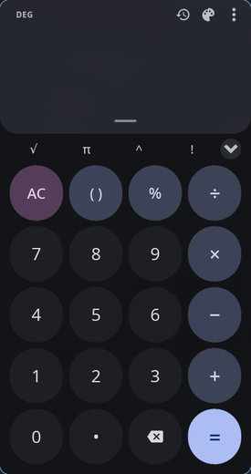<br><b>Material You</b></td>
    <td align="center">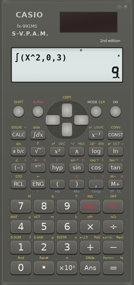<br><b>Casio fx-991MS</b></td>
    <td align="center">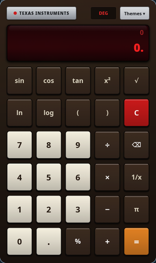<br><b>TI Datamath 1977</b></td>
    <td align="center">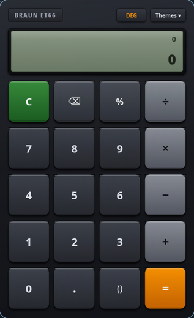<br><b>Braun ET66</b></td>
  </tr>
  <tr>
    <td align="center">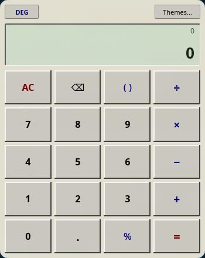<br><b>Classic Desktop</b></td>
    <td align="center">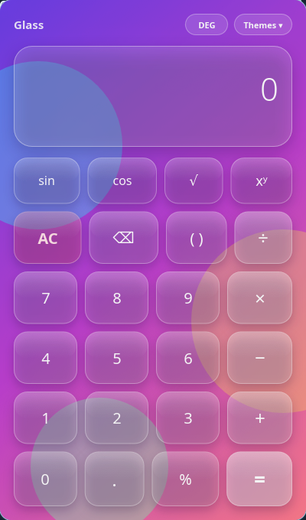<br><b>Glassmorphism</b></td>
    <td align="center">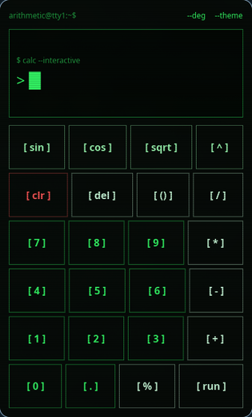<br><b>Terminal</b></td>
    <td align="center">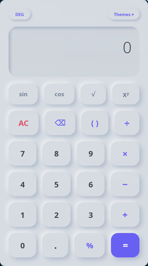<br><b>Neumorphism</b></td>
  </tr>
  <tr>
    <td align="center">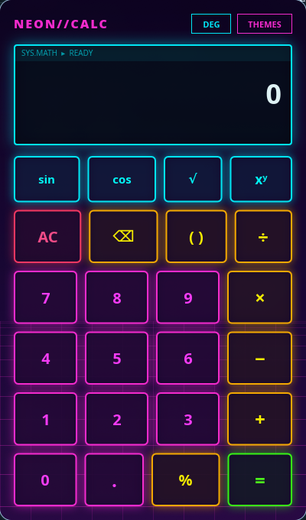<br><b>Cyberpunk Neon</b></td>
    <td align="center">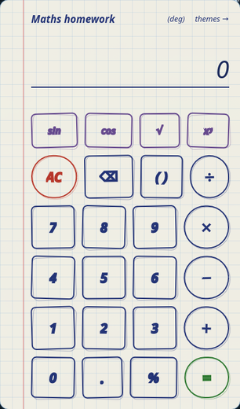<br><b>Paper Notebook</b></td>
    <td align="center">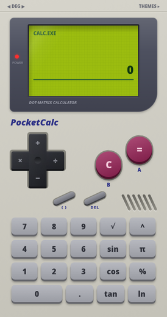<br><b>Retro Handheld</b></td>
    <td align="center">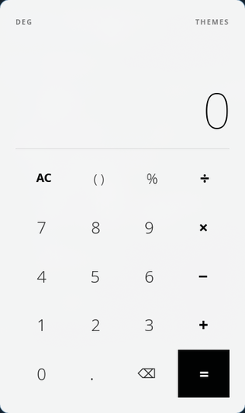<br><b>Minimal Mono</b></td>
  </tr>
  <tr>
    <td align="center">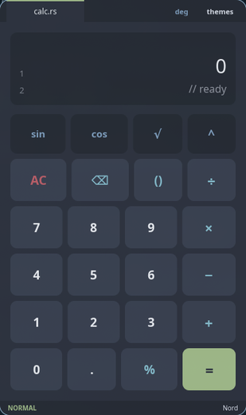<br><b>Dev Palettes</b></td>
    <td align="center">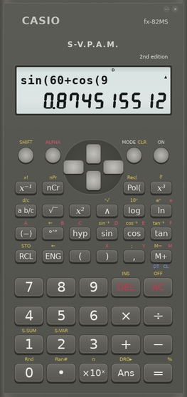<br><b>Casio fx-82MS</b></td>
    <td align="center">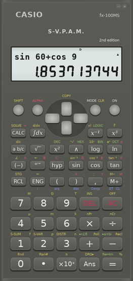<br><b>Casio fx-100MS</b></td>
  </tr>
</table>

#### Layouts

<table>
  <tr>
    <td align="center">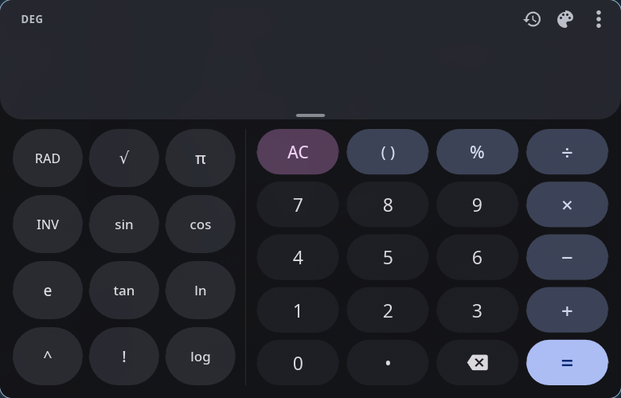<br><b>Material You · Large</b></td>
    <td align="center">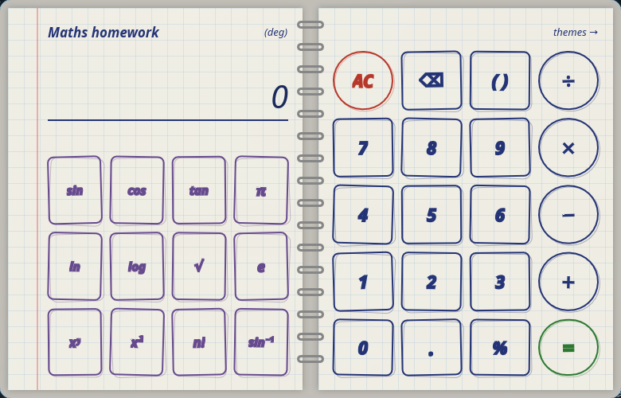<br><b>Paper Notebook · Open Spread</b></td>
  </tr>
  <tr>
    <td align="center">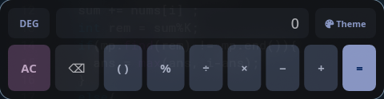<br><b>Material You · Compact</b></td>
    <td align="center">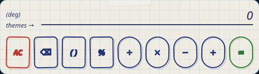<br><b>Paper Notebook · Sticky Note</b></td>
  </tr>
</table>

#### Colour themes

<table>
  <tr>
    <td align="center">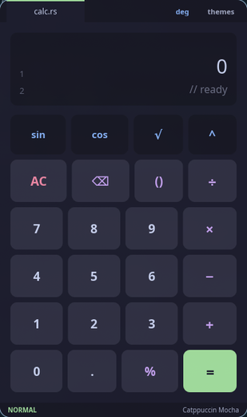<br><b>Dev Palettes · Mocha</b></td>
    <td align="center">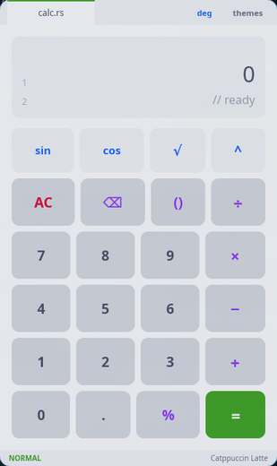<br><b>Dev Palettes · Latte</b></td>
    <td align="center">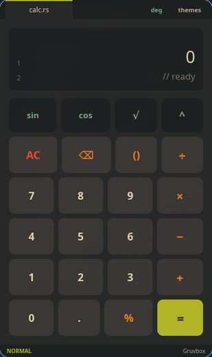<br><b>Dev Palettes · Gruvbox</b></td>
    <td align="center">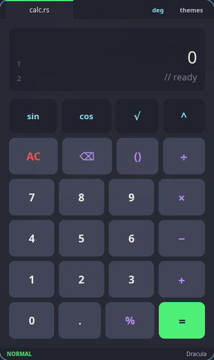<br><b>Dev Palettes · Dracula</b></td>
    <td align="center">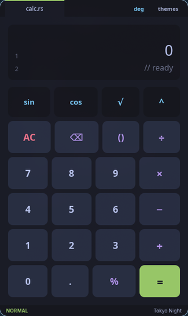<br><b>Dev Palettes · Tokyo Night</b></td>
  </tr>
  <tr>
    <td align="center">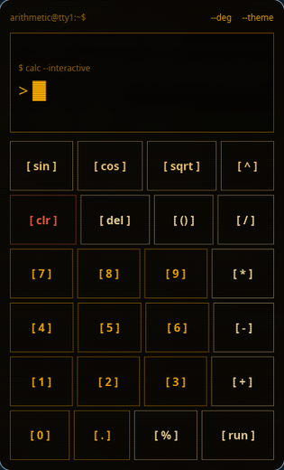<br><b>Terminal · Amber</b></td>
    <td align="center">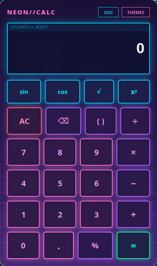<br><b>Cyberpunk Neon · Vaporwave</b></td>
    <td align="center">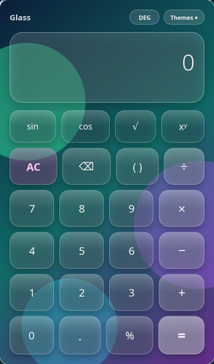<br><b>Glassmorphism · Aurora</b></td>
    <td align="center">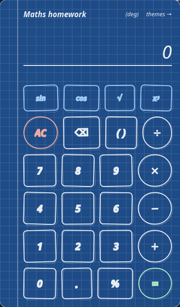<br><b>Paper Notebook · Blueprint</b></td>
    <td align="center">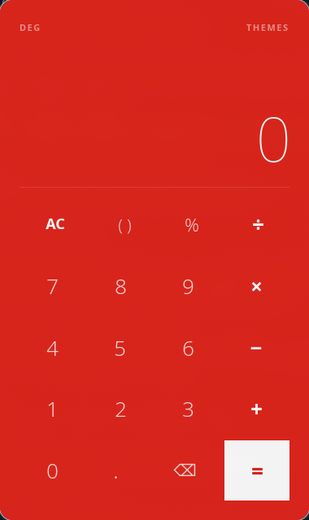<br><b>Minimal Mono · Swiss Red</b></td>
  </tr>
</table>

### Bundled Skins

| ID | Layouts | Colour themes | Style |
| --- | --- | --- | --- |
| `material-3` | Standard, Compact, Large | System, Light, Dark | Material You with history drawer and scientific panel |
| `classic-desktop` | Standard | Classic, Slate, High Contrast | 90s desktop calculator with bevelled keys |
| `casio-fx991ms` | Standard | — | Casio fx-991MS 2nd edition drawn entirely in Slint (no images): 7-segment LCD, SHIFT/ALPHA and all eight modes |
| `casio-fx82ms` | Standard | — | Casio fx-82MS 2nd edition drawn entirely in Slint (no images): 7-segment LCD, SHIFT/ALPHA, COMP, SD and REG |
| `casio-fx100ms` | Standard | — | Casio fx-100MS 2nd edition drawn entirely in Slint (no images): 7-segment LCD, SHIFT/ALPHA, COMP, CMPLX, SD, REG, BASE and EQN |
| `ti-datamath-1977` | Standard | Original Brown, Black LCD | 1970s TI Datamath with red LED display |
| `braun-et66` | Standard | Black, White | Dieter Rams' Braun ET66 |
| `glassmorphism` | Standard | Sunset, Ocean, Aurora | Frosted glass over a gradient |
| `terminal` | Standard | Green, Amber, Cyan | Phosphor console with scanlines |
| `neumorphism` | Standard | Light, Dark, Sand | Soft extruded keys |
| `cyberpunk-neon` | Standard | Neon, Vaporwave, Toxic | Neon glow over a synthwave grid |
| `dev-palettes` | Standard | Nord, Catppuccin Mocha, Catppuccin Latte, Gruvbox, Dracula, Tokyo Night | Editor colour schemes |
| `paper-notebook` | Notebook, Sticky Note, Open Spread | Graph Paper, Legal Pad, Blueprint | Hand-inked keys on paper |
| `retro-handheld` | Standard | Classic Grey, Pocket Silver, Berry | Dot-matrix handheld with D-pad operators |
| `minimal-mono` | Standard | Light, Dark, Swiss Red | Swiss-style type with no borders or shadows |

### Installing a Skin

Copy the skin folder into one of these directories (searched in this order; the first skin with a given ID wins):

1. `~/.config/arithmetic/skins/<skin-id>/`
2. `~/.local/share/arithmetic/skins/<skin-id>/`
3. `<exe-dir>/skins/` and `<exe-dir>/../share/arithmetic/skins/`
4. `$APPDIR/skins/` (inside the AppImage)
5. `/usr/share/arithmetic/skins/` and `/usr/local/share/arithmetic/skins/` (bundled skins)

Then press **Reload** in the skin picker. Reload also recompiles the active
skin, so you can edit a skin and see the result immediately. Debug builds
(`cargo run`) load this repository's `skins/` folder first.

### Writing a Skin

A skin is a folder containing a `manifest.json`, one `.slint` file per layout,
and any images or helper `.slint` files it needs:

```json
{
  "id": "my-skin",
  "name": "My Skin",
  "version": "1.0.0",
  "author": "You",
  "description": "One line shown in the skin picker",
  "preview": "previews/dark.png",
  "default_layout": "standard",
  "layouts": [
    { "id": "standard", "name": "Standard", "file": "skin.slint", "width": 400.0, "height": 680.0 },
    { "id": "compact", "name": "Compact", "file": "compact.slint", "width": 520.0, "height": 150.0 }
  ],
  "default_color_theme": "dark",
  "color_themes": [
    { "id": "dark", "name": "Dark", "swatch": ["#1E1E2E", "#CBA6F7"], "preview": "previews/dark.png" },
    { "id": "light", "name": "Light", "swatch": ["#EFF1F5", "#8839EF"], "preview": "previews/light.png" }
  ],
  "engine": { "implicit-mul-first": "on", "digits": "10" }
}
```

| Field | |
| --- | --- |
| `layouts` | at least one; `width` / `height` is the window size in logical pixels |
| `default_layout` | layout used the first time the skin is opened |
| `color_themes` | optional; leave it out (or empty) for a skin with a single look |
| `swatch` | one to three hex colours drawn as the theme's swatch in the picker |
| `preview` | optional image shown in the picker; a colour theme's own `preview` takes precedence |
| `engine` | optional [engine settings](#settings) applied while the skin is active, so it can behave like the calculator it looks like |

Each layout file must export a component named `AppWindow` that inherits `Window`.
Skins are compiled in isolation. They can import other files from their own
folder (and use `std-widgets.slint`), but nothing from the application or
from other skins. To share code between a skin's layouts, put it in a file in
the skin's folder, as `skins/paper-notebook/parts.slint` does.

Arithmetic drives the skin through these properties and callbacks. Only the
ones marked *required* must exist; declare the rest only if your skin uses them.

| Name | Kind | |
| --- | --- | --- |
| `expression` | `in-out property <string>` | required: current input |
| `preview-result` | `in-out property <string>` | required: live result, or the error message |
| `is-error` | `in-out property <bool>` | required: `preview-result` holds an error |
| `use-radians` | `in-out property <bool>` | required: angle unit |
| `press-key(string)` | `callback` | required: see key strings below |
| `open-skin-dialog()` | `callback` | required: opens the skin picker |
| `color-theme` | `in-out property <string>` | required if the manifest lists `color_themes`: the active theme ID |
| `set-color-theme(string)` | `callback` | change and save the colour theme from inside the skin |
| `toggle-angle-unit()` | `callback` | switches DEG / RAD |
| `cursor-byte-offset` | `in-out property <int>` | caret position, for skins with an editable `TextInput` |
| `expression-edited()` | `callback` | call after the user edits `expression` directly |
| `set-cursor(int)` | `public function` | host moves the caret after a key press |
| `just-evaluated` | `in-out property <bool>` | the expression is a fresh result |
| `history` | `in-out property <[HistoryEntry]>` | `HistoryEntry { expression: string, result: string }` |
| `select-history-item(string)` | `callback` | load a history value into the input |
| `clear-history()` | `callback` | wipe saved history |
| `switch-skin(string)` | `callback` | jump straight to another skin by ID |
| `close-window()` | `callback` | quit, for frameless skins |
| `submit-expression(string)` | `callback` | evaluate a whole expression at once, e.g. from a skin's own input form |
| `set-setting(string, string)` | `callback` | change an [engine setting](#settings), e.g. `set-setting("notation", "fix:2")` |
| `setting-<key>` | `in-out property <string>` | the current value of a setting, e.g. `setting-angle` is `"deg"`, `setting-base` is `"hex"` |
| `memory-active` | `in-out property <bool>` | memory `M` holds a non-zero value, for an "M" indicator |
| `expression-before-cursor`, `expression-after-cursor` | `in-out property <string>` | the input split at the caret, for skins that draw their own cursor |
| `evaluate(string) -> string` | `pure callback` | the result of an expression as the display would show it, without changing anything (`""` on error) |
| `evaluate-exact(string) -> string` | `pure callback` | the same at full precision in plain decimal, for feeding back into later expressions |
| `characters(string) -> [string]` | `pure callback` | text split into single characters, e.g. to draw each one as a 7-segment digit |
| `split-exponent(string) -> [string]` | `pure callback` | `"1.5E-07"` → `["1.5", "-07"]`; other text → `[text, ""]` |
| `split(string, string) -> [string]` | `pure callback` | text split at a separator, e.g. `split("1+1:2+2", ":")` → `["1+1", "2+2"]` |

The easiest way to support colour themes is a `global` in the skin whose
colours depend on `color-theme`, bound to the window's property:

```slint
global Colors {
    in-out property <string> color-theme: "dark";
    out property <color> background: color-theme == "light" ? #EFF1F5 : #1E1E2E;
}

export component AppWindow inherits Window {
    in-out property <string> color-theme <=> Colors.color-theme;
    background: Colors.background;
    // ...
}
```

Changing the colour theme in the picker only sets `color-theme`, so it applies
instantly; changing the layout loads the other `.slint` file.

**Key strings** for `press-key`. A few keys are commands:

| Key | Action |
| --- | --- |
| `=` | evaluate |
| `AC` | clear the input |
| `BACKSPACE` | delete the last character, or a whole name such as `sin(` or `ans` |
| `()` | smart bracket: opens or closes as needed |
| `M+`, `M−`, `MC`, `MR` | evaluate and add to / subtract from memory, clear memory, recall memory |
| `LEFT`, `RIGHT`, `HOME`, `END` | move the caret, over whole names such as `sin(` |
| `CLEAR-VARIABLES` | set every variable, `ans` and `M` back to 0 |

**Any other key text is inserted as typed**, so a skin can offer any engine
feature just by sending its text: `7`, `+`, `sin(`, `nCr(`, `[`, `;`, `{`,
`→A`, `°`, `i`, `solve(`, `_km`, and so on. See [the engine syntax](#calculator-engine).
A key that starts a new value (a digit, a function, a constant or a variable)
replaces the previous result instead of extending it.

Any bundled skin is a good starting point: `skins/glassmorphism/` is a
complete single-file example with colour themes, and `skins/paper-notebook/`
shows several layouts sharing one file of parts.

---

## Calculator Engine

The engine (`src/core/engine`) turns text into a result in three stages:
a lexer, a parser and an evaluator. It imitates no particular calculator:
everything that differs between models is a [setting](#settings), and every
feature is plain text, so any skin can use all of it.

### Syntax

| Write | Meaning |
| --- | --- |
| `1+2×3`, `2^3^2`, `-2^2` | usual precedence; `^` is right-associative; `-2^2` is −4 |
| `2π`, `3(4+5)`, `2sin(30)` | implicit multiplication |
| `5!`, `50%` | factorial, percent |
| `1.5E3`, `0x1F`, `0b101`, `0o17`, `0d15` | scientific notation, hexadecimal, binary, octal, decimal (useful while the input base is not decimal) |
| `h1F`, `b101`, `o17`, `d15` | the same in word mode, written the way calculators' BASE modes show them |
| `{1, rep(2, 3)}` | a list inside a list is spliced in: `{1, 2, 2, 2}`; `rep(x, n)` repeats a value, e.g. data with a frequency |
| `sin(30)`, `sin 30`, `√9`, `log(8, 2)` | functions, with or without brackets for one argument |
| `sin −30`, `log 10^3`, `sin 30+1` | without brackets the argument takes a sign, powers and `!`, but not `×÷+−`: `log(10^3)`, `sin(30)+1` |
| `7nCr3`, `7nPr4`, `3ˣ√27` | `nCr` / `nPr` and the x-th root between their values, as typed on a calculator |
| `5→A`, `A+ans` | store in a variable (`A`–`F`, `X`, `Y`, `M`); `ans` is the last result |
| `1→A : A+1` | several statements; the result is the last one |
| `×4`, `2+3 : ×4` | a statement starting with an operator (not `−`) carries on from `ans` |
| `[1, 2; 3, 4]` | a matrix: `,` between columns, `;` between rows |
| `{1, 2, 3}` | a list; operators and most functions work item by item |
| `3+4i` | complex numbers |
| `12°30′15″`, `30°`, `1ʳ`, `100ᵍ` | an angle marked in degrees (and minutes, seconds), radians or gradians, converted to the current angle unit |
| `5∠53.13` | a complex number from its length and angle |
| `_c`, `_h`, `_NA` | physical constants (CODATA 2018, SI units) |
| `convert(5, _km, _mi)` | unit conversion |
| `solve(X^2 = 2, 1)` | an equation in `X`, solved near a starting guess |

A missing `)` at the end is fine: `sin(30` works.

### Functions

| Group | Functions |
| --- | --- |
| Trigonometry | `sin cos tan asin acos atan` (also `sin⁻¹` …), `sinh cosh tanh asinh acosh atanh` |
| Powers and logs | `sqrt` (`√`), `cbrt` (`∛`), `root(x, n)`, `exp`, `ln`, `log(x)` / `log(x, base)`, `log2` |
| Parts and rounding | `abs sign floor ceil int frac`, `round(x, places)`, `gamma` |
| Complex numbers | `re im arg conj` |
| Coordinates | `pol(x, y)` → `{r, θ}`, `rec(r, θ)` → `{x, y}`, `hypot` |
| Whole numbers | `mod gcd lcm nPr nCr isprime` |
| Bitwise | `and or xor xnor not neg shl shr` (on `word-bits`-bit words) |
| Random | `rand`, `randint(a, b)` |
| Statistics | `sum prod count rep mean median var varp sd sdp min max sort` |
| Regression | `linreg quadreg logreg expreg powreg corr`, each `(xs, ys)` |
| Distributions | `normpdf normcdf invnorm binompdf binomcdf poissonpdf poissoncdf` |
| Matrices | `det inv trn trace iden linsolve` |
| Lists | `item(list, n)`: the n-th value, from 1 (also for vectors) |
| Vectors | `dot cross norm unit angle` |
| Equations | `roots(a, b, c, d)` (polynomials up to cubic), `solve(f = g, guess)` |
| Calculus | `integrate(f, a, b)` (`∫`), `derivative(f, a)` (`d/dx`), `sigma(f, a, b)` (`Σ`), `product(f, a, b)` (`Π`), `table(f, start, end, step)` |

`solve`, `integrate`, `derivative`, `sigma`, `product` and `table` work on an
expression in `X`.

Each function, constant and unit is a single entry in a table
(`functions/*.rs`, `constants.rs`, `units.rs`). The lexer, the parser and
the evaluator all read from these tables, so you add something by adding a
line.

### Settings

Settings change how the engine behaves. A skin sets them in the `engine` map
of its manifest, or at runtime with `set-setting(key, value)`.

| Key | Values | Default | |
| --- | --- | --- | --- |
| `angle` | `deg`, `rad`, `grad` | `deg` | angle unit |
| `notation` | `normal`, `fix:N`, `sci:N`, `eng` | `normal` | how results are written |
| `digits` | `1`–`15` | `10` | significant digits in normal notation |
| `normal-min` | `-15`–`0` | `-7` | normal notation switches to scientific below 10^N (Casio Norm 1 is `-2`, Norm 2 is `-9`) |
| `base` | `dec`, `bin`, `oct`, `hex` | `dec` | base for whole-number results |
| `fractions` | `on`, `off` | `off` | show `0.75` as `3/4` |
| `dms` | `on`, `off` | `off` | show results as degrees, minutes and seconds |
| `complex` | `on`, `off` | `off` | let real operations give complex results: `√(−4)` = `2i` |
| `implicit-mul-first` | `on`, `off` | `off` | implicit `×` binds tighter: `6÷2(1+2)` = 1 instead of 9 |
| `percent` | `fraction`, `of-left` | `fraction` | `of-left` makes `200+10%` = 220 |
| `word-bits` | `1`–`64` | `64` | word size for the bitwise functions |
| `word-mode` | `on`, `off` | `off` | whole-number arithmetic on `word-bits`-bit words; negatives shown in two's complement |
| `input-base` | `dec`, `bin`, `oct`, `hex` | `dec` | base for typed numbers without a prefix, e.g. `FF` in `hex` |
| `complex-form` | `rect`, `polar` | `rect` | show complex results as `a+bi` or `r∠θ` |

---

## Keyboard Shortcuts

| Key | Action |
| --- | --- |
| `0` - `9`, `.` | Input numbers and decimal point |
| `+`, `-`, `*`, `/` | Arithmetic operators |
| `^`, `%`, `!` | Power, percentage, factorial |
| `(`, `)` | Parentheses |
| `Enter` or `=` | Calculate result |
| `Backspace` | Delete character or token |
| `Esc` or `C` | Clear input |
| `T` or `F2` | Open the skin picker |

---

## License

Distributed under the [MIT License](LICENSE).
